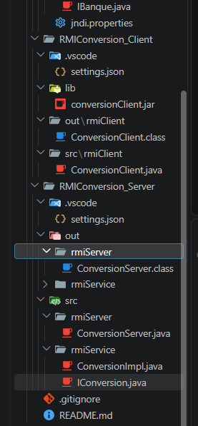
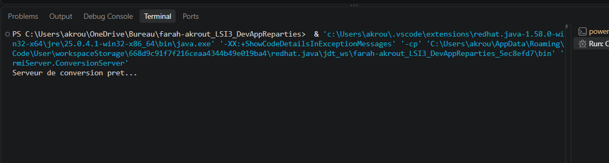
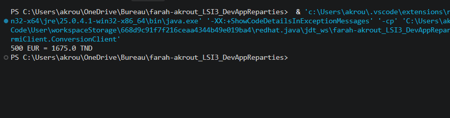
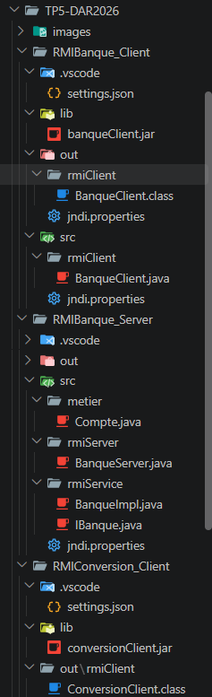
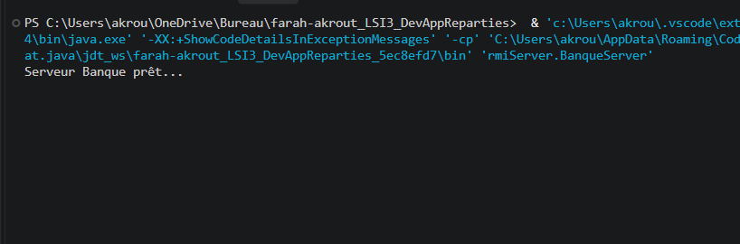
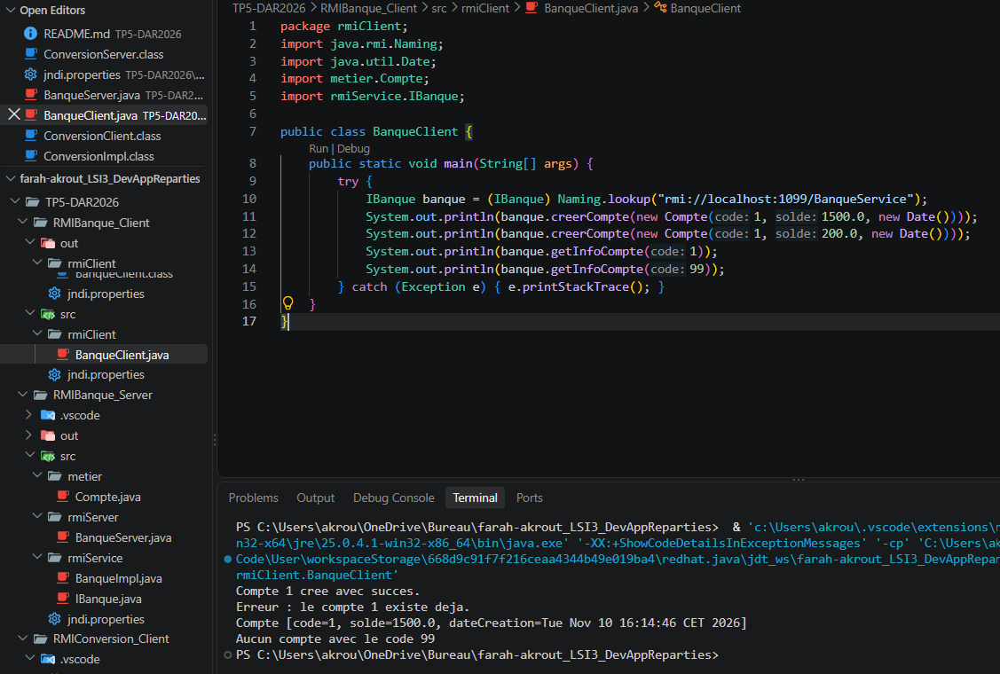
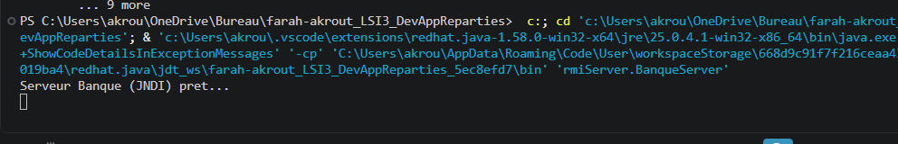
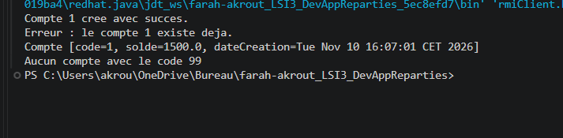

# TP5 : Invocation de méthodes sur des objets distants avec Java RMI

**Étudiante :** Farah Akrout, LSI3
**Matière :** Développement d'applications réparties
**Environnement :** JDK, VS Code

# Activité 5-1 : Service de conversion de devise

## Objectif

Concevoir une application répartie avec Java RMI. Le serveur convertit un montant en euros vers le dinar tunisien (taux utilisé : 1 EUR = 3.35 TND).

## Étape 1 : Préparation de l'espace de travail



## Étape 2 : Développement du serveur

Dans `RMIConversion_Server` :

- Package `rmiService` : l'interface distante `IConversion` (méthode `double convertirMontant(double mt)`) et son implémentation `ConversionImpl`.
- Package `rmiServer` : la classe `ConversionServer`, qui active le RMIRegistry (port 1099), crée l'objet `ConversionImpl` et le publie sous le nom `ConversionService`.

## Étape 3 : Développement du client

- Export de l'interface `IConversion` seule (sans `ConversionImpl`) dans le fichier `conversionClient.jar`.
- Ajout du JAR au classpath du projet `RMIConversion_Client` (dossier `lib`).
- Package `rmiClient` : la classe `ConversionClient`, qui recherche l'objet distant dans le registre et appelle `convertirMontant(500)`.

## Étape 4 : Exécution

**1. Lancement du serveur**



**2. Lancement du client**



Résultat : `500 EUR = 1675.0 TND`.

---

# Activité 5-2 : Service de banque avec RMI et JNDI

## Objectif

Développer une application répartie qui gère des comptes bancaires. Un compte est défini par un code (`int`), un solde (`double`) et une date de création (`Date`). Le serveur offre deux services distants :

- `String creerCompte(Compte c)` : crée un compte si le code n'existe pas déjà.
- `String getInfoCompte(int code)` : consulte un compte à partir de son code.

## Étape 1 : Préparation de l'espace de travail

Création des projets `RMIBanque_Server` et `RMIBanque_Client`.



## Étape 2 : Développement du serveur

Dans `RMIBanque_Server` :

- Package `metier` : la classe sérialisable `Compte`.
- Package `rmiService` : l'interface distante `IBanque` et son implémentation `BanqueImpl` (les comptes sont stockés dans une `HashMap`).
- Package `rmiServer` : la classe `BanqueServer`.

## Étape 3 : Développement du client

- Export de `IBanque` et `Compte` (sans `BanqueImpl`) dans le fichier `banqueClient.jar`.
- Ajout du JAR au classpath de `RMIBanque_Client`.
- Package `rmiClient` : la classe `BanqueClient`.

## Étape 4 : Exécution avec le RMI classique (`Naming`)

Dans cette version, le serveur utilise `LocateRegistry` et `Naming.rebind`, et le client utilise `Naming.lookup`.

**1. Lancement du serveur**



**2. Lancement du client** (le code `Naming.lookup` et le résultat sont visibles)



Résultats obtenus :

- création du compte 1 avec succès ;
- erreur lors de la deuxième création du compte 1 (le code existe déjà) ;
- affichage des informations du compte 1 ;
- message « Aucun compte avec le code 99 ».

## Étape 5 : Utilisation de JNDI

Le serveur et le client n'utilisent plus `Naming` : ils passent par `InitialContext`. La configuration est placée dans le fichier `jndi.properties`, dans le dossier `src` du serveur **et** du client :

```properties
java.naming.factory.initial=com.sun.jndi.rmi.registry.RegistryContextFactory
java.naming.provider.url=rmi://localhost:1099
```

- Serveur : `ctx.rebind("BanqueService", new BanqueImpl())`
- Client : `ctx.lookup("BanqueService")`

**1. Lancement du serveur (JNDI)**



**2. Lancement du client (JNDI)**



Les résultats sont identiques à ceux de la version classique : la communication RMI fonctionne toujours avec le nouveau mode d'enregistrement.

---

# Synthèse

## Ce que j'ai appris

- **RMI** permet à un client d'appeler une méthode d'un objet qui se trouve dans un autre programme, comme si elle était locale. Le calcul s'exécute côté serveur.
- **L'interface distante** (`IConversion`, `IBanque`) décrit les méthodes accessibles à distance. Elle étend `Remote`, et chaque méthode déclare `RemoteException`.
- **L'implémentation** (`ConversionImpl`, `BanqueImpl`) reste uniquement sur le serveur. Le client reçoit seulement l'interface, grâce au fichier JAR.
- **Le RMIRegistry** est l'annuaire où le serveur publie l'objet distant et où le client le recherche par son nom. Le client récupère un _stub_, qui représente l'objet distant.
- **`Compte` est `Serializable`** : cet objet voyage entre le client et le serveur, c'est pourquoi il doit aussi se trouver dans le JAR du client.

## Cycle de vie d'un service distant

Définition de l'interface, implémentation, enregistrement dans l'annuaire, puis invocation par le client.
